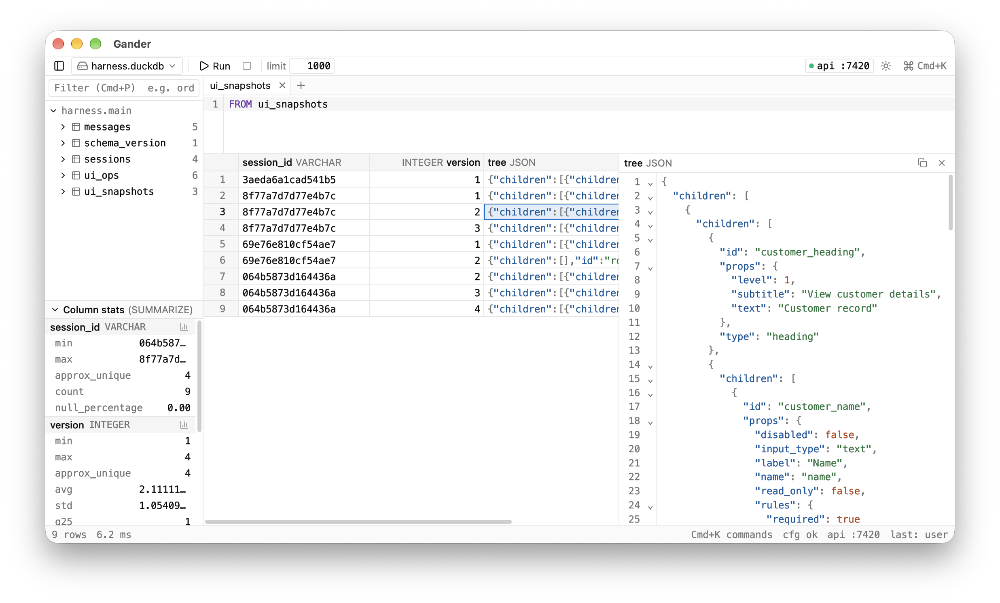

# Gander

A compact DuckDB data viewer built with Tauri v2, React and shadcn/ui. Type SQL in tabs, browse results in a dense grid, and let an agent read and drive the active tab through a localhost API. How it works, including the API, config files and the agent skill, is described in [`design.md`](design.md).



## Develop

You need Rust 1.85 or later (the crate uses the 2024 edition), Node with pnpm, and Python 3 for the CLI.

```
pnpm install
pnpm tauri dev                 # app with hot reload
pnpm tauri build --debug --no-bundle
src-tauri/target/debug/gander /path/to/workspace
```

The first directory argument is the workspace. Relative file paths in queries resolve against it, and `query.sql` lives in its `.gander/` folder. Without an argument the last workspace is reused.

## Test

```
cd src-tauri && cargo test                              # unit tests and API end-to-end test
python3 -m unittest discover -s skill/gander/tests      # CLI tests
pnpm typecheck
```

## Release

### Build

Run the test suite first (see "Test" above), then:

```
CI=true pnpm tauri build
```

This writes:

- `src-tauri/target/release/bundle/macos/Gander.app`
- `src-tauri/target/release/bundle/dmg/Gander_<version>_<arch>.dmg`, for example `Gander_0.1.0_aarch64.dmg`

`CI=true` makes the disk image script skip the Finder window layout. Without it the script drives Finder through AppleScript, which times out in a terminal or agent session and fails the build after the `.app` is already made.

The build targets the machine's architecture, so on Apple Silicon you get an arm64 build only. An Intel or universal build needs `rustup target add x86_64-apple-darwin` and `pnpm tauri build --target universal-apple-darwin`; that path has not been tried yet.

The app is ad hoc signed (`"signingIdentity": "-"` in `tauri.conf.json`), with no Developer ID and no notarization. A copy built on your own machine opens normally. A copy downloaded from elsewhere, such as a GitHub release, is quarantined, and the first launch shows "Apple could not verify 'Gander' is free of malware". To open it, click Done, then go to System Settings > Privacy & Security, scroll down to the message about Gander, click Open Anyway and enter your password. Right click and Open no longer skips this check on macOS 15 and later. Alternatively, run `xattr -dr com.apple.quarantine /Applications/Gander.app` once after installing.

Without the `signingIdentity` setting only the executable carries the linker's signature, the bundle is not sealed, and a downloaded copy is reported as damaged with no Open Anyway option. Check a build with `codesign --verify --deep --strict src-tauri/target/release/bundle/macos/Gander.app`, which should print nothing.

Signing also turns on the hardened runtime, which normally refuses to load libraries signed by someone else. DuckDB extensions are such libraries, so `src-tauri/Entitlements.plist` sets `com.apple.security.cs.disable-library-validation`. Without it, `INSTALL` succeeds but `LOAD` fails with "mapping process and mapped file (non-platform) have different Team IDs".

### Test the release

Test the `.dmg`, since that is what gets shipped. The steps below install it into a temporary folder and point Gander at temporary config and state directories, so your real `~/.config/gander`, `~/.local/state/gander` and installed copy are left alone. The config sets `port = 0` because a Gander that is already running holds port 7420; the release would then start without its API and the CLI checks would fail.

1. From the repository root, install from the disk image into a scratch folder. The glob assumes the `dmg` folder holds one image; delete older ones first.

   ```
   T=$(mktemp -d)
   hdiutil attach -nobrowse -quiet -mountpoint "$T/mnt" src-tauri/target/release/bundle/dmg/Gander_*.dmg
   cp -R "$T/mnt/Gander.app" "$T/" && hdiutil detach -quiet "$T/mnt"
   ```

2. Make a workspace with test data and an isolated config:

   ```
   mkdir -p "$T/ws" "$T/cfg"
   printf '[server]\nport = 0\n' > "$T/cfg/config.toml"
   python3 -c "
   import json, random
   with open('$T/ws/logs.jsonl', 'w') as f:
       for i in range(3000):
           f.write(json.dumps({'id': i, 'level': random.choice(['info', 'warn', 'error']), 'ctx': {'user': i % 50, 'tags': ['a', 'b'][: i % 3]}}) + '\n')
   "
   printf 'name,age\nann,31\nbo,42\n' > "$T/ws/people.csv"
   ```

3. Start the release build in the background. Run the remaining steps in this same terminal, because the `GANDER_*` variables exist only here. Closing the terminal or quitting Gander ends the test.

   ```
   export GANDER_CONFIG_DIR="$T/cfg" GANDER_STATE_DIR="$T/state"
   "$T/Gander.app/Contents/MacOS/gander" "$T/ws" &
   ```

4. In the same shell, check the API, the query wrapper and live reload with the CLI. Expected output is in the comments.

   ```
   G="python3 skill/gander/scripts/gander.py"
   $G status                                    # source: Files only, empty query
   $G run "FROM 'logs.jsonl'" --rows 2          # truncated: showing 2 of 1000+ rows (limit 1000)
   $G sort id:desc --rows 1                     # first row has id 2999
   $G stats                                     # one row per column, count 3000
   printf '[server]\nport = 0\n[query]\nlimit = 10\n' > "$T/cfg/config.toml"
   $G status                                    # limit: 10, truncated at 10+
   printf "FROM 'people.csv'" > "$T/ws/.gander/query.sql"
   $G query                                     # FROM 'people.csv', also visible in the editor
   printf '[server]\nport = 0\n[ui]\nnope = 1\n' > "$T/cfg/config.toml"
   $G status                                    # config error: .../config.toml:3: unknown field `nope`
   ```

   Wait a second after each `printf` for the file watcher.

5. Check the UI by hand. These parts have no automated tests:

   - The grid is dense, numbers are right aligned, and NULL is muted.
   - Clicking a header sorts and re-runs; shift click adds a second sort column. The truncation bar and the amber row count appear while the result is cut at the limit.
   - Hovering a JSON cell (the `ctx` column) for a moment opens a pretty-printed popover. `Space` on a focused cell opens it too, and `Enter` pins it to the side panel.
   - The copy buttons on cells and rows paste the right text. `Cmd+C` copies the selection.
   - Column stats at the bottom left start collapsed and fill in when opened. Clicking a column group scrolls the grid to that column.
   - `Cmd+T`, `Cmd+W`, `Cmd+1`-`9` and `Cmd+Shift+[` / `]` work on tabs, and `Cmd+W` closes a tab, not the window.
   - `Cmd+K` opens the palette with history, `Cmd+P` focuses the schema filter, `Cmd+B` toggles the sidebar, and `Cmd+I` toggles the stats.
   - Open DuckDB file... in the source menu opens a `.duckdb` file. The schema tree fills in, and the filter matches `ord am` style terms.
   - Dropping a `.parquet`, `.csv` or `.jsonl` file on the window opens it in a new tab.
   - Quit and relaunch: the tabs and their text come back.

6. Clean up: quit Gander, then `rm -rf "$T"`.

### Test the executable directly

For a quicker check during development, run the executable inside the built `.app` in place and skip the disk image. Replace step 1 with `T=$(mktemp -d)`, then follow steps 2 to 6, starting the app in step 3 with:

```
export GANDER_CONFIG_DIR="$T/cfg" GANDER_STATE_DIR="$T/state"
src-tauri/target/release/bundle/macos/Gander.app/Contents/MacOS/gander "$T/ws" &
```

The same works for a copy dragged into `/Applications`, using `/Applications/Gander.app/Contents/MacOS/gander`. Start it from the shell. An app opened from Finder or with `open` does not inherit the `GANDER_*` variables, so it reads your real config and state directories instead of the test ones.

This skips the check that the disk image mounts and contains the app, so test the `.dmg` once before shipping.

## Files

| Path | Purpose |
|---|---|
| `~/.config/gander/config.toml` | Global config, reloaded on change |
| `~/.config/gander/schema.json` | JSON Schema for the config, written on start |
| `<workspace>/.gander/config.toml` | Workspace overrides. Its `[[connections]]` need approval in the app, and its `[server]` table is ignored |
| `<workspace>/.gander/query.sql` | Text of the active tab, two-way synced |
| `~/.local/state/gander/server.json` | API port, pid and per-launch API key while the app runs |
| `~/.local/state/gander/trusted_workspaces.json` | Workspace configs you approved |

The app and the CLI resolve the two base directories the same way. For config, `GANDER_CONFIG_DIR` comes first, then `$XDG_CONFIG_HOME/gander`, then `~/.config/gander`. For state, `GANDER_STATE_DIR` comes first, then `$XDG_STATE_HOME/gander`, then `~/.local/state/gander`.

## Agent skill

`skill/gander/` holds `SKILL.md` and `scripts/gander.py`. Install it by linking the folder:

```
mkdir -p ~/.claude/skills
ln -s "$PWD/skill/gander" ~/.claude/skills/gander
```

The API listens on 127.0.0.1 at the port set by `[server] port` in the global config. The default is 7420, and `0` picks a free port. The CLI never reads `config.toml`. It reads `server.json`, which the app writes with the port it actually bound, so a custom port or `port = 0` needs no CLI setup. If `server.json` is missing, the CLI falls back to the `GANDER_URL` environment variable. While the file exists, `GANDER_URL` is ignored.

The API always requires a key. Without one in the config, Gander makes a new key each launch and writes it to `server.json`, where the CLI picks it up. If the config sets a key, export it as `GANDER_API_KEY` for the CLI. Apps launched from Finder do not inherit shell environment variables, so `api_key_env` only works when Gander is started from a shell; use `api_key` otherwise.
